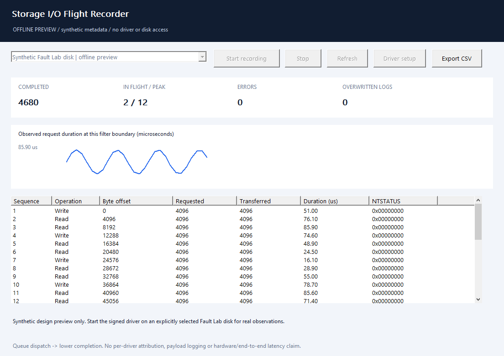

# Storage I/O Flight Recorder - Windows Kernel Disk Filter & C++ SDK

**Explain raw scratch-disk I/O completions with bounded metadata, exact NTSTATUS and a small native integration API.**

Built for virtual-storage QA, raw block-workload regression tests and OEM diagnostic integrations. The private KMDF upper filter timestamps read and write requests at its own dispatch/completion boundary. The native Windows viewer displays completions, in-flight counts, errors and overwritten-log counts; explicitly export the visible metadata to CSV.

**App/SDK engineering preview for Windows x64.** Microsoft driver signing and production qualification are pending. Public downloads contain the native application, CLI, SDK, example and installer sources. An unsigned driver or a setup executable without a signed payload is not distributed as a usable public installation.



## Scope

| Included | Boundary |
| --- | --- |
| Read/write completion metadata | Byte offset, requested/actual transfer length, NTSTATUS, sequence, start/completion QPC and observed in-flight depth. Flush and other requests pass through without timing records. |
| Explicit per-disk attachment | The owned, present, unpartitioned **64 MiB Titan Storage Fault Lab** synthetic disk; no DiskDrive class-wide association. |
| Bounded transport | Up to 16 attached filters, one active recorder, 256 records per disk, at most 32 records per read. |
| Owner cleanup | An administrator owns the exclusive control handle; closing it stops collection and clears queued metadata. |
| Native integration | `SDK/StorageRecorder.h` and `SDK/StorageRecorder.cpp`; synchronous bounded control calls. |

This edition accepts only the [Virtual Storage Fault Lab](https://github.com/titanfyre/Virtual-Storage-Fault-Lab) synthetic disk, checking its adapter ancestor/service, opened-handle vendor/product/serial, capacity, sector size and blank layout. Physical disks and other virtual disks are **read-only inventory entries**, never eligible attachment targets in this preview. System disks and partitioned/unknown media are refused. This is **not yet an everyday system-drive incident recorder**. Keep the selected media disposable. Detachment remains available if it was partitioned after attachment.

The recorder does not inspect disk contents, collect file paths, attribute processes, modify a transfer, inject errors or impose delays. The lower stack's completion status and information are forwarded unchanged. A full log overwrites old records and reports the count; it does not queue storage traffic for the UI. Kernel filtering still has overhead and requires deployment qualification.

## Install and use

1. Download and extract the complete x64 ZIP from [Releases](https://github.com/titanfyre/Storage-IO-Flight-Recorder/releases).
2. For an offline tour, run `StorageRecorderApp.exe --preview`. Its synthetic values are labelled and do not open the recorder or any disk.
3. Once the Microsoft-signed evaluation bundle is available, run `StorageRecorderSetup.exe` as administrator and choose **Install package**. This installs only the primitive driver package; no disk is automatically attached.
4. Install a separately signed **Virtual Storage Fault Lab** disk, keep it unpartitioned, explicitly select it, choose **Attach selected**, and restart Windows when requested. Existing per-device filters are preserved. Setup does not restart disks or Windows automatically. Close other device installers while editing associations; a detected concurrent change is retained and reported instead of overwritten.
5. Open `StorageRecorderApp.exe` as administrator, choose the matching attached PDO and select **Start recording**. Generate the raw workload using your own authorized QA tool. The viewer itself never generates disk reads/writes.
6. Stop recording before device maintenance. **Detach selected** removes only the recorder association. Restart when requested. Uninstall removes the product's associations first; if a restart is needed, run Uninstall again afterwards to remove the unused package.

Console setup offers `/install`, `/attach "exact DiskDrive instance"`, `/detach "exact DiskDrive instance"`, `/status` and `/uninstall`. A supplied signed installer verifies its Microsoft production catalog, INF/SYS membership and exact product identity before installation or attachment. Source-only installer builds have no embedded signed package. Never disable production security to load a preview.

```powershell
StorageRecorderCLI.exe --disks
StorageRecorderCLI.exe --devices
StorageRecorderCLI.exe --record 1 30
```

`--disks` is read-only Windows inventory. `--devices` returns IDs and PDO names of recorder filters actually loaded; use that ID for the explicit 30-second metadata session. IDs last for the current driver/device lifetime, not across reboot or reattachment. Match PDO names to `SPDRP_PHYSICAL_DEVICE_OBJECT_NAME` when integrating your own device selection.

## Minimal C++ use

Compile the two SDK files with C++17 on Windows x64 and link `setupapi.lib` and `cfgmgr32.lib`.

```cpp
#include "StorageRecorder.h"

StorageRecorder::Session recorder;
auto devices = recorder.Devices(); // Requires an attached driver and elevation.
if (!devices.empty()) {
    recorder.Start(devices.front().Id);
    auto inputs = recorder.Read(); // Immediate bounded drain; may be empty.
    for (unsigned i = 0; i < inputs.Count; ++i) {
        const auto& io = inputs.Events[i];
        double us = StorageRecorder::Microseconds(io, inputs.Stats.Frequency);
        // Inspect io.Operation, io.TransferredBytes, io.Status and us.
    }
} // Scope exit closes the owner and clears its queued metadata.
```

Use a worker loop for a longer recording, as shown in [Examples/record.cpp](Examples/record.cpp). Stop all callers before destroying a `Session`; its individual calls are serialized. Exceptions contain an English stage and Windows error code where applicable.

`Status()` returns aggregate counters for the selected recording generation. `Read()` drains up to 32 completion records and returns the counters alongside them. `Stop()` closes the owner handle. `Disks()` inventories Windows disk identity and the current conservative attachment eligibility; it never attaches or modifies a disk.

## Interpret the timing

Start QPC is taken when this filter's KMDF queue dispatches a supported request; completion QPC is taken when the lower stack returns it. The interval includes lower drivers, device/service time and scheduling. It excludes application buffering and any time before that dispatch boundary. In-flight depth describes only this filter's observed cohort.

It is **not** physical-media latency, a breakdown of each driver below the filter, an application end-to-end measurement, or proof of zero overhead. Completion order can differ from sequence order. A failed request can still carry completion information. Ring overflow loses diagnostic records, not the I/O itself. UI refresh cadence affects presentation only.

Windows ETW/WPR/WPA already provides rich disk tracing and is often the right first tool. This component targets teams needing a bounded, embeddable native collector with a small stable protocol at an explicitly selected filter boundary. See [validation](docs/VALIDATION.md) and [commercial scope](docs/COMMERCIAL.md).

## Build

Visual Studio 2022 Desktop C++, CMake and a Windows SDK are required. No WDK or private kernel sources are needed for the public application build.

```powershell
.\Build.ps1
.\Build.ps1 -Asan
# Optional: embed a separately received Microsoft-signed opaque package.
.\Build.ps1 -DriverPackageDirectory C:\Signed\TitanStorageFlightRecorder
```

Outputs are under `obj/Build/bin/Release`. Offline tests exercise protocol validation and one million reproducible malformed-record cases without opening a disk or loading a driver. The kernel source remains private; driver signing and runtime qualification are separate from compiling the public app.

## OEM integration and responsible use

For **paid scoped QA/integration pilots, OEM redistribution rights, a branded driver package or Windows compatibility/support**, add **`titancsa` on Discord**. Bring a reproducible scratch-disk workload, target Windows builds and intended deployment volume. Acceptance tests and supported configurations are agreed before production delivery.

Public app/SDK/example/installer sources use the [MIT license](LICENSE). Kernel binary evaluation and production redistribution have separate terms. This preview does not implement an enforced timer, online activation, or a payment system. Microsoft signing alone is not WHQL certification, product endorsement or evidence of universal reliability.

Use only on systems and disposable test media you own or are authorized to administer. The project is intended for lawful diagnostics and software integration. You remain responsible for your deployment and use; the applicable licenses describe the terms and warranty limitations.
